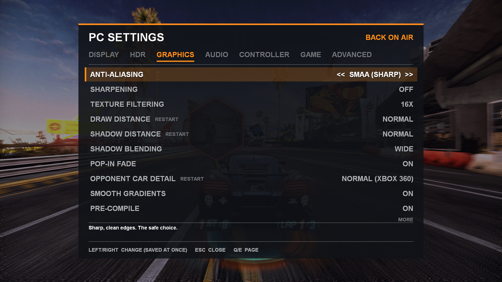
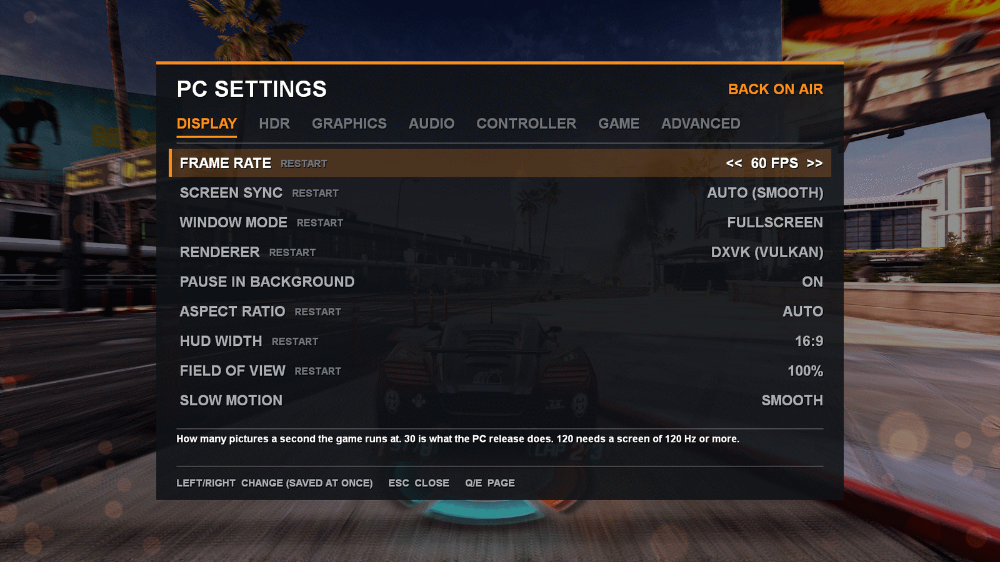

# Back on Air, a PC patch for Split/Second

## How to install (short version)

Quit the game first. The full details are under [Install](#install) and [Uninstall](#uninstall) below.

Windows:

1. Download the zip from the [Releases page](https://github.com/xenophobentx/back-on-air/releases).
2. Unpack the whole zip anywhere.
3. Double-click `install.bat`. It finds the game through Steam. If it cannot, it asks for the folder with
   `SplitSecond.exe`. If it cannot write into the game folder, right-click `install.bat` and select "Run as
   administrator".
4. Start Split/Second from Steam. Open PC SETTINGS with F1, by holding Back / View on the pad, or with Y on the
   game's Options screen.
5. To uninstall, double-click `uninstall.bat`.

Steam Deck and Linux:

1. On the Deck, switch to Desktop Mode. Download the zip from the [Releases page](https://github.com/xenophobentx/back-on-air/releases) and unpack it anywhere.
2. If you have never started the game, start it once from Steam and quit it. The script needs the game's Proton
   folder, and Steam makes it on the first start.
3. Open the unpacked folder in the file manager, right-click an empty place, select "Open Terminal Here", type
   `sh install.sh` and press Enter. It finds the game in every Steam library, the SD card included, and tells
   Proton to load the patch. You do not need a launch option.
4. Start Split/Second from Steam. Open PC SETTINGS by holding View (Back), with Y on the game's Options screen, or
   with F1.
5. To uninstall, run `sh uninstall.sh` in the same folder.

The settings overlay (F1, or hold Back on a pad). Changes save at once.

## What it is

Back on Air is an unofficial patch for the Steam release of Split/Second (Windows, and Linux / Steam Deck through
Proton). It is one file, `dinput8.dll`, which sits next to `SplitSecond.exe`, plus a settings file,
`splitsecond.conf`.

The patch never changes the game's files or code. Remove `dinput8.dll` and the game is as it shipped. Without
`splitsecond.conf` the DLL does nothing at all.

What it does:

* 60 fps (the game ships locked to 30), and 120 fps or more in single-player races.
* Settings inside the game (PC SETTINGS): press F1, hold Back / View on a pad, or press Y on the game's Options
  screen.
* Picture: anti-aliasing (SMAA, FXAA, TAA), sharpening, texture filtering, longer draw and shadow distances,
  smoother shadows, fade-in instead of pop-in, smoother gradients, the Xbox 360's opponent car detail and slipstream
  effect, HDR, ultrawide screens (21:9, 32:9), field of view, borderless and windowed modes.
* Frame pacing without judder at 60 or 120, and a mode for G-Sync / FreeSync screens.
* Sound: the console's reverb, mix and surround placement are back. The opponents' engines play again. Each sound
  group has its own volume.
* Controllers: every XInput pad works as an Xbox 360 pad, and so do PlayStation, Nintendo and generic pads. Pads
  connected later work too. Dead zones, vibration strength, and button icons for your pad (Xbox, PlayStation,
  Nintendo, Steam Deck, keyboard).
* Comfort: skip the intro movies and Press Start, keep playing when the window loses focus, automatic save
  backups.
* Pre-compile: no stutter in the first race on a track (Windows with DXVK).

It is made for Steam build 385319 of the game.

## Install

Unpack the whole zip into a folder first. Quit the game before you install, update or uninstall.

The zip holds:

| File | What it is |
|---|---|
| `dinput8.dll` | the patch |
| `splitsecond.conf` | the settings, with the default values and a comment for each |
| `dxvk\` | DXVK 2.7.1 (Direct3D 9 on Vulkan), used on Windows only |
| `pipeline-warmup\` | the pre-compile records of the five track groups (shader hashes and states) |
| `install.bat`, `install.ps1`, `uninstall.bat` | Windows install script |
| `install.sh`, `uninstall.sh` | Linux and Steam Deck install script |
| `README.md`, `THIRD_PARTY_NOTICES.md` | this guide, the licences |

### Windows

Double-click `install.bat`. It finds the game through Steam. If it cannot, it asks for the game folder (the folder
with `SplitSecond.exe`). If it says it cannot write into the game folder, right-click `install.bat` and select
"Run as administrator".

### Steam Deck and Linux

1. On the Deck, switch to Desktop Mode.
2. Open the unpacked folder in the file manager. Right-click an empty place and select "Open Terminal Here".
3. Type `sh install.sh` and press Enter.

The script finds the game in every Steam library (SD card and Flatpak Steam too). It tells Proton to load the
patch, so you do not need a launch option.

If the game has never been started, its Proton folder does not exist yet. The script then says so. Start the game
once, quit it, and run the script again.

If Steam resets the game's Proton folder (another Proton version, or "delete compatibility data"), run the script
again. Or set this launch option instead (Steam > Split/Second > Properties > General > Launch options):

    WINEDLLOVERRIDES="dinput8=n,b" %command%

### What the scripts do

* They copy `dinput8.dll`, `splitsecond.conf` and `pipeline-warmup` (and on Windows the `dxvk` folder) next to
  `SplitSecond.exe`.
* Before they replace anything, they move it into `patch-backup\<date>` in the game folder.
* A `d3d9.dll` next to `SplitSecond.exe` (an older way to install DXVK) is moved into the backup.
* They stop if the game is running, or if the old "Split/Second HFR" mod is installed (`DXFreezerServer.dll`). That
  mod freezes the game together with this patch: remove `DXFreezerServer.dll` and `SplitSecondHFR.ini` first.
* They never change the game's own files or your saves. Run them twice and nothing changes.

### Update

Run the install script of the new zip. Your `splitsecond.conf` stays as it is. The new defaults go next to it as
`splitsecond.conf.new`; compare the two if you want. A setting that is missing from your file uses its default.

### Install by hand

1. Find the game folder: Steam > Split/Second > Properties > Installed Files > Browse.
2. Copy `dinput8.dll`, `splitsecond.conf` and the `pipeline-warmup` folder into it. On Windows also copy the
   `dxvk` folder.
3. If there is a `d3d9.dll` next to `SplitSecond.exe`, move it away.
4. Linux and Steam Deck only: set the launch option `WINEDLLOVERRIDES="dinput8=n,b" %command%`.

## Uninstall

* Windows: double-click `uninstall.bat`.
* Steam Deck and Linux: open a terminal in the unpacked folder (as for the install) and type `sh uninstall.sh`.
  `sh install.sh --uninstall` does the same.

It removes the patch's files and puts back what the install had moved away. Your settings file goes into
`patch-backup\<date>-uninstall`. It does not touch your saves, `save-backups`, `shader-cache` (you can delete it),
`patch-backup` or `splitsecond-online.key` (your online account key). If you set the launch option,
remove it in Steam.

By hand: delete `dinput8.dll`, `splitsecond.conf`, the `splitsecond-patch*.log` files, `pipeline-warmup` and (Windows) `dxvk`
from the game folder, and remove the launch option.

## Settings in the game

Open PC SETTINGS with F1, by holding Back / View for about a second, or with Y (Tab on the keyboard) on the game's
Options screen. Up / down selects a row, left / right changes it, A / Enter starts an action row, B / Esc closes,
LB / RB or Q / E turn the page. A line under the rows says what the selected row does.

Every change goes into `splitsecond.conf` at once. A row marked RESTART takes effect the next time you start the
game. The pages are DISPLAY, HDR (only on an HDR screen), GRAPHICS, AUDIO, CONTROLLER, GAME and ADVANCED.

The DISPLAY page. The race keeps going behind it.

## Settings file

`splitsecond.conf` is a text file next to `dinput8.dll`. Each line is `key = value`. A line that starts with `#` is a
comment. A missing key uses its default. The file in the zip has a comment for every key. Below is the short list.

### Display

| Key | Default | What it does |
|---|---|---|
| `fps` | `60` | `30` = the game as it ships (nothing patched). `60`. `120`. `native` = the screen's refresh rate. A number from 61 to 240. Above 60 applies to single-player races; menus and loading stay at 60. |
| `frame_pacing` | `auto` | `auto` / `smooth`: every frame waits for the screen, no tearing. `fastest`: no wait, lowest latency, can tear. `vrr`: for a G-Sync / FreeSync screen, holds the race just under the refresh rate (116 at 120 Hz). |
| `window_mode` | `fullscreen` | `fullscreen`, `borderless`, `windowed`. Leave `fullscreen` on the Steam Deck. |
| `extra_resolution` | (none) | Borderless / windowed only: one more size in the game's resolution list, e.g. `2560x1080`. |
| `renderer` | `dxvk` | Windows only. `dxvk` = DXVK from the `dxvk` folder (120 fps, HDR). `native` = Windows' own Direct3D 9 (see Known limits). |
| `pause_on_focus_loss` | `true` | `false` = the game keeps running and playing sound when another window is in front. |
| `aspect` | `auto` | `auto` widens the picture on a screen wider than 16:9 (more at the sides) and keeps the HUD undistorted. `16:9` = as the game ships. Or a shape like `21:9`. |
| `hud_width` | `16:9` | The HUD and menus on a wide screen: `16:9`, `21:9`, `full` (stretched, as the game ships), `letterbox`. |
| `fov` | `100` | Field of view in percent of the game's (50-150). |
| `slow_half_steps` | `true` | Crash and takedown slow motion at 60 different pictures a second (`false`: 30). |
| `takedown_realtime` | `true` | Slow motion and takedown replays at their real speed at 60 fps (else double speed). |
| `game_vsync` | `game` | The game's own vsync option: `game`, `off`, `on`. `frame_pacing` wins over it. Not in the overlay. |

### HDR

HDR needs DXVK (Windows with `renderer = dxvk`, or Proton) and a screen in HDR mode. On the Steam Deck OLED: Game
Mode with HDR on. Without HDR the picture is the normal one.

| Key | Default | What it does |
|---|---|---|
| `hdr` | `false` | `true` = HDR output. Switches live from the overlay. |
| `hdr_ready` | `true` | Prepares HDR at start so the HDR row can switch it live. |
| `hdr_peak` | `0` | Your screen's peak brightness in nits. `0` = ask the screen. |
| `hdr_paper_white` | `240` (Deck `200`) | Brightness of the game's normal white, in nits (120-400). |
| `hdr_hud` | `0` | HUD and menu brightness. `0` = 0.8 x paper white. |
| `hdr_highlights` | `1.5` | How far bright light goes above paper white: 1-3. |
| `hdr_lift` | `3` | How much lamps, signs and glows stand out: 0-4. |
| `hdr_shadows` | `1` | Deeper darks: 1 (off) to 1.2. |

The overlay also has CALIBRATE HDR, a test screen for these values.

### Graphics

| Key | Default | What it does |
|---|---|---|
| `aa` | `smaa` | Anti-aliasing: `off`, `fxaa`, `smaa`, `taa`, `taa_high`. The HUD stays sharp. |
| `smaa_predication` | `true` | SMAA also uses depth: cleaner edges, less blur on text and textures. |
| `taa_lod_bias` | `-0.5` | With TAA: slightly sharper textures (-2 to 0). |
| `sharpen` | `0` | Sharpening: 0, 0.25, 0.5, 0.75, 1. |
| `anisotropy` | `game` | Texture filtering: `game` (PC original), `off`, 2-16. |
| `draw_distance` | `console` | Scenery detail distance: `console`, `1.5`, `2`. |
| `shadow_distance` | `console` | How far sun shadows reach: `console`, `1.5`, `2`. |
| `shadow_smoothing` | `high` | Hides the hard line where shadow detail changes: `off`, `on`, `high`. |
| `shadow_softness` | `console` | Shadow edge width: `0.75`, `console`, `1.25`, `1.5`. |
| `lod_smoothing` | `on` | Objects fade in instead of popping in: `off`, `on`, `high`. |
| `deband` | `on` | Removes visible steps in dark skies, fog and glow. |
| `opponent_cars` | `console` | Opponent car detail: `pc` (as shipped), `console` (Xbox 360), `high`. |
| `slipstream_fix` | `true` | The Xbox 360's draft streaks at the front of the car. |
| `shader_cache` | `true` | Keeps the patch's compiled shaders in `shader-cache`, so the next start is faster. |
| `pipeline_warmup` | `auto` | Pre-compile (see below): `auto` / `on`, `off`. |

### Audio

| Key | Default | What it does |
|---|---|---|
| `reverb` | `true` | The authored reverb of each place (the PC release has one small room everywhere). |
| `reverb_level` | `100` | Reverb amount in percent. |
| `console_mix` | `true` | The Xbox 360's sound mix (`false` = the PC release's). |
| `audio_sidechain` | `true` | Ducking: crashes and Power Plays turn the music and engines down for a moment, as designed. |
| `audio_voice_dsp` | `true` | 3D position of the cars' sounds (front, back, side, distance). |
| `audio_speaker_fix` | `true` | 5.1: effects on the front speakers, as on the console. |
| `audio_cpu_engines` | `true` | The opponents' engines play (silent in the PC release). |
| `audio_fsb_fix` | `true` | Fixes short pieces of wrong sound at the start of sounds and in looping music. |
| `volume_master`, `volume_music`, `volume_sfx`, `volume_engines`, `volume_voice`, `volume_ambience` | `100` | Volume per group in percent (0-200). |
| `volume_player_engine`, `volume_opponent_engines`, `volume_collisions`, `volume_powerplays`, `volume_swooshes`, `volume_surfaces`, `volume_particles`, `volume_hyperreal`, `volume_camera`, `volume_hud`, `volume_general_ambience`, `volume_spot_ambience` | `100` | Finer volumes (ADVANCED page). |
| `sfx_trim` | `0` | Older flat effects trim in dB (negative values only). |

### Controller

| Key | Default | What it does |
|---|---|---|
| `pad_support` | `true` | Every XInput pad works as an Xbox 360 pad. The overlay's pad control needs it. |
| `pad_rumble`, `pad_rumble_gain` | `true`, `100` | Vibration on / off, strength in percent (0-200). |
| `pad_deadzone_left`, `pad_deadzone_right` | `6` | Stick dead zones in percent. |
| `pad_trigger_threshold` | `5` | Trigger dead zone in percent. |
| `pad_hotplug` | `true` | A pad connected after the start works. |
| `pad_translate_dinput` | `true` | Older pads (DirectInput only: PlayStation, Nintendo, generic) work as Xbox pads. |
| `pad_foreground_only` | `false` | `true` = ignore pads while another window is in front. |
| `button_prompts` | `auto` | Button icons: `auto` (the device you used last), `xbox360`, `xbox`, `playstation`, `nintendo`, `steam`, `keyboard`. |

### Game

| Key | Default | What it does |
|---|---|---|
| `skip_intro` | `true` | Skips the intro movies (title screen in about 14 s instead of 75). |
| `boot_to_menu` | as `skip_intro` | Passes Press Start for you: straight to the main menu. |
| `save_backups` | `10` | At every start, a copy of your saves goes into `save-backups\<date>` in the game folder. Keeps the newest N (0 = off). |
| `options_prompt` | `true` | The PC SETTINGS (Y) button on the game's Options screen. |
| `menu` | `true` | `false` = no overlay at all. |

### Online (experimental)

The game's own online servers closed long ago. The patch points the game at a replacement server
(`vps4954.rackhostvps.com`) and signs you in by itself. This is on by default, also when your `splitsecond.conf`
comes from an older build and has no `online_server` line. Online is experimental. To keep the game offline, set
`online_server = off`.

| Key | Default | What it does |
|---|---|---|
| `online_server` | `vps4954.rackhostvps.com` | Server host name or address (the port stays the game's 31120). A name is resolved at start. If it does not resolve, the log says so and online does not connect. No such line, or an empty value, means the default server. `off` = the game stays offline. |
| `online_autologin` | `true` | With a server set, the patch signs you in by itself. Your name is your Steam name plus a 3-character tag. Accents become plain letters (`Árpád` → `Arpad`), Cyrillic becomes Latin letters, and a name with no letter left (Chinese, Japanese, Korean, only symbols) becomes `Racer` plus the tag. The account key is `splitsecond-online.key` next to the DLL. Copy it to use the same account on another PC. |
| `online_name` | (empty) | A different name instead of the Steam name (up to 12 characters; the tag is added). |

Your online account is the file `splitsecond-online.key` in the game folder. The 3-character tag comes from this
key. Keep the file. The uninstaller does not remove it, and an update does not change it. To play with the same
account on another PC, copy the file there. Without the old file (deleted, or a new PC) the patch makes a new key.
You then get a new tag, which means a new name and a new account. The old account stays on the server, but you
cannot sign in to it without its key.

Races are peer to peer, as with the game's original servers: the games of a race send to each other directly. So
any signed-in player can get the public address of any player who is online.

What works (tested with three games on 2026-11-14): sign-in and account creation, a public (ranked) lobby, the race
itself, and the results after it. The server also has a public statistics page at
[vps4954.rackhostvps.com/backonair](https://vps4954.rackhostvps.com/backonair/): who is online, open games, daily numbers. What does not work yet:

* So far races have run only between PCs on one home network. Between players behind different home routers a
  race may fail. The fix for that (a relay on the server) is not in this release.
* Private games with invitations: the server refuses them, and the friends list is empty. A public race needs 3
  players, so 2 players alone cannot race.
* No leaderboards in the game.

### For testing and diagnosis

These are off by default. You only need them when you report a problem.

| Key | What it does |
|---|---|
| `frame_log` | A frame-time line in the log every 10 s, and a line for each long stall. |
| `display_log` | Logs device resets (alt-tab, resolution changes). |
| `vm_log = N` | Logs the game's free memory every N seconds (Windows: the 2 GB limit). |
| `pad_log` | Logs button presses. |
| `audio_diag`, `audio_music_log` | Sound logs. |
| `menu_developer` | Shows the DEVELOPER page in the overlay. |
| `loop_sleep`, `net_poll`, `dxvk_fit` | Performance fixes, `auto` by default; change only if asked. |
| `hfr_ticks`, `hfr_rewind`, `hfr_steering` | Corrections above 60 fps, on by default; change only if asked. |
| `mixer`, `mixer_map`, `sfx_trim_categories` | Fine control of the sound groups. |
| `env.NAME = value` | Sets an environment variable for the game, e.g. `env.DXVK_HUD = fps`. |
| `overlay_dir`, `dlc_tracks`, `dlc_save_profile` | DLC experiments; leave them off. |

`docs/technical.md` in the source describes every key and every part in full.

## Pre-compile (first-race stutter)

With DXVK, the first race on each track stutters, because the graphics driver builds its pipelines the first time it
sees each effect. Later races are smooth until the driver's cache is cleared (for example by a driver update).

Pre-compile builds those pipelines while the track loads. It is on by default when the `pipeline-warmup` folder is
there.

* The first load of each track takes about 30 s instead of 5 s. After that, loads take about 5 s again.
* GRAPHICS > PRE-COMPILE ALL TRACKS (in the main menu) builds every track at once. It takes a few minutes and shows
  its progress on the row. Press again to stop.
* With pre-compile on, DXVK uses 4 compiler threads to save memory. This takes effect at the next start.

We measured it on Windows with an AMD GPU (Airport Terminal, empty driver cache). Without pre-compile there were 16
stalls of 100 ms or more, the worst 1.4 s. With pre-compile, none went over 70 ms.

## Known limits

* NVIDIA GPUs are untested. We have only tested on AMD so far (Steam Deck, Linux desktop, Windows). If you try it on
  NVIDIA, please send your log (see Troubleshooting). With DXVK on NVIDIA under Windows we have not measured the
  memory use in a race. If a race load crashes, set `vm_log = 30`, send the log, and use `renderer = native` in the
  meantime. In the NVIDIA control panel, leave the game's 3D settings at their defaults (no forced anti-aliasing,
  V-Sync or frame limit).
* Renderer on Windows: `dxvk` (the default) holds 120 fps and gives HDR, but without pre-compile the first race on a
  track stutters. `native` (Windows' own Direct3D 9) has no race stutter, but it reaches only about 110 fps when
  aiming for 120 (60 is fine) and has no HDR. On Linux and the Steam Deck, Proton always uses its own DXVK and the
  `renderer` key does nothing.
* Pre-compile was measured on Windows only. It is on for the Steam Deck and Linux too, but we have not measured it
  there yet.
* Above 60 fps applies to single-player races only. Split screen and online stay at 60. The crash rewind is shorter
  (360/fps seconds instead of 6). Some timings above 60 are not checked yet.
* Steam Deck OLED (90 Hz): set the screen to 60 Hz in the Performance menu, because 60 frames cannot be spaced
  evenly at 90 Hz. The same goes for a 144 Hz monitor: use 60 or 120 Hz.
* Windows memory: the game is a 32-bit program with 2 GB of memory. The patch keeps DXVK inside that limit
  (`dxvk_fit`), but very high settings plus DXVK leave less room.
* TAA (`aa = taa` / `taa_high`) can smear slightly on fast-moving cars, because the game gives no per-object motion.
* Online is experimental. It uses one replacement server (`online_server`). Races are tested on one home network
  only, private games with invitations do not work, and a public race needs 3 players. See
  [Online](#online-experimental).

## Troubleshooting

* Nothing changes in the game: check that `dinput8.dll` and `splitsecond.conf` are next to `SplitSecond.exe`. On
  Linux / Steam Deck, run `sh install.sh` again or set the launch option. The patch writes `splitsecond-patch.log`
  next to the DLL. If that file is not there, the DLL was not loaded.
* The game freezes at start: remove the old HFR mod (`DXFreezerServer.dll`).
* Crash in a race load on Windows: set `renderer = native` and try again. Send the log with `vm_log = 30`.
* Judder at 60 fps on the Steam Deck OLED or a 144 Hz monitor: set the screen to 60 Hz (or 120 Hz).
* The overlay does not open with the pad: it needs `pad_support = true`. F1 always works.
* A setting says RESTART NEEDED: quit and start the game again.
* Your settings seem gone after an update: the installer keeps your `splitsecond.conf`. After an uninstall, it is
  in the newest `patch-backup` folder.
* Online sign-in fails every time: look for `[online] sign-in as "..." failed` in the log. If the server is up, the
  name belongs to another key. Put back the `splitsecond-online.key` that made the account, or set
  `online_name = <another name>` in `splitsecond.conf`.
* Lost or broken save: quit the game first. Then copy the files from the newest folder in `save-backups` into
  `Documents\Disney Interactive Studios\Split Second\` (on the Steam Deck this is inside the game's Proton folder,
  `steamapps/compatdata/297860/pfx/drive_c/users/steamuser/Documents/...`).

When you report a problem, send `splitsecond-patch.log` from a session that shows it. After a crash and a restart,
the crashed session's log is `splitsecond-patch.prev.log`. Say which GPU, which system (Windows, Steam Deck, other
Linux) and which `fps` setting you use. For stutter, also set `frame_log = true`. The log holds your online name,
but not the PC's name, its LAN address or the user name in a folder path (that one reads `<user>`).

## Release notes

### 2026-11-16: 1.0.3

* The Power Play icons over rival cars keep the Xbox 360 size at any resolution. Above 720p they grew too big
  (3 times at 4K) and could cover the road.

### 2026-11-15: 1.0.2

* HDR now works on NVIDIA graphics cards under Windows. The dxvk.conf workaround is no longer needed.
* The HDR calibration pattern now works on screens that tone map by themselves, such as OLEDs.
* At start the patch checks that SplitSecond.exe is the untouched Steam version. If it is not, the patch turns
  itself off and says so. It also warns about other mods in the game folder.
* The log now starts first, so a start that fails still leaves a trace.

### 2026-11-15: 1.0.1

* Fixed red contour lines over the whole picture on NVIDIA graphics cards when texture filtering was set above
  PC original. Anisotropic filtering now goes only to normal surface textures.
* Texture filtering now defaults to PC original (the game's own setting). 2x to 16x are still in the menu.

### 2026-11-14: first release

Frame rate and pacing

* 60 fps everywhere. 120 fps (or the screen's rate, up to 240) in single-player races, with steering, rewind,
  scripted sequences and slow motion corrected for the higher rate.
* Frame pacing on a fixed grid with the screen's vblank. `fastest` for the lowest latency. `vrr` for G-Sync /
  FreeSync, capped just below the refresh rate.
* Performance fixes for the Steam Deck and Proton (the game's per-frame sleep and network check).

Picture

* SMAA (with depth), FXAA and TAA. Contrast-adaptive sharpening.
* Texture filtering, longer draw and shadow distances, the Xbox 360's opponent car detail.
* Fade-in instead of pop-in for scenery, props, moving objects and their shadows.
* Smooth shadow cascade hand-over, adjustable shadow softness, debanding.
* The Xbox 360's slipstream streaks.
* HDR10 output with calibration, switched live (DXVK).
* Ultrawide: a wider picture with an undistorted HUD. Field of view. An extra resolution for windowed play.
* Borderless and windowed modes. The game can keep running in the background.

Windows

* Renderer switch: DXVK 2.7.1 (shipped in the zip) or Windows' own Direct3D 9.
* DXVK kept inside the game's 2 GB of memory.
* Pre-compile: no stutter in the first race on a track, and PRE-COMPILE ALL TRACKS.

Sound

* The authored reverb of each place, the Xbox 360 mix, ducking, 3D placement and 5.1 levels.
* The opponents' engines play again. The sound bank fix. Volume groups.

Controllers

* Every pad works as an Xbox 360 pad, older DirectInput pads included, and so do pads connected later.
* Dead zones, vibration strength, and button icons for Xbox, PlayStation, Nintendo, Steam Deck and keyboard.

Comfort

* PC SETTINGS overlay in the game (F1, hold Back / View, or Y on the Options screen).
* Skip the intro movies and Press Start.
* Automatic save backups.
* Install and uninstall scripts for Windows and Linux / Steam Deck.

Online (experimental)

* The game connects to a replacement online server (`vps4954.rackhostvps.com`) and signs in by itself with your
  Steam name. The server is the built-in default, so this also works with a `splitsecond.conf` from an older build.
  `online_server = off` keeps the game offline.
* `splitsecond-online.key` is your online account key. The uninstaller keeps it.

## Licence and credits

The patch's own code is under the MIT licence (`LICENSE`). It contains no part of the game. The zip ships DXVK
2.7.1 (zlib licence) unchanged in `dxvk\`. See `THIRD_PARTY_NOTICES.md` for DXVK, SMAA, FXAA and the other
parts this patch uses.

Back on Air is an unofficial fan project, not affiliated with or endorsed by Disney or Black Rock Studio. You need
your own copy of the game.
